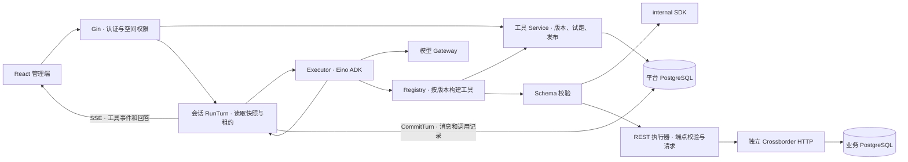
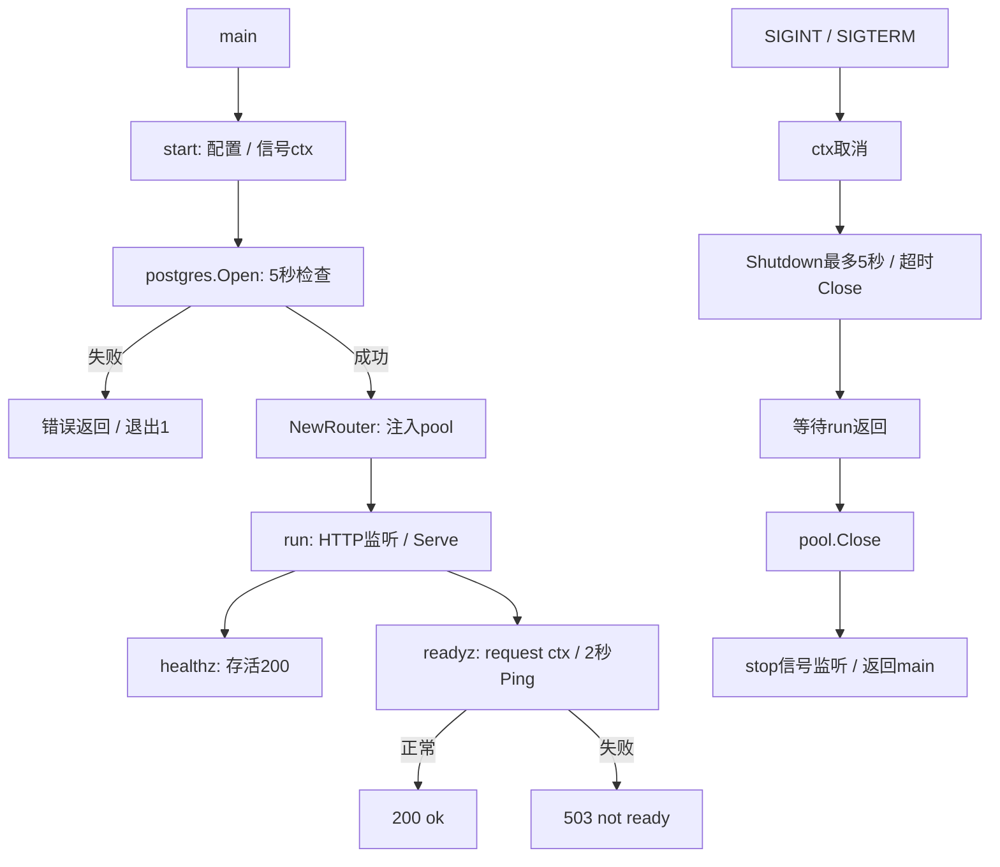
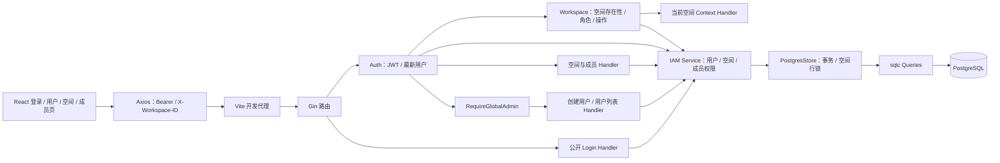
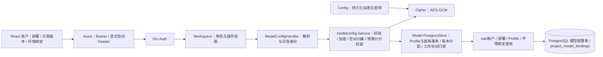
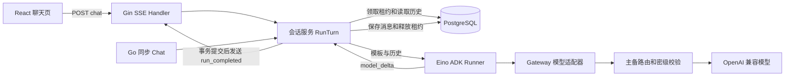

# AsterFlow · 星流

**企业级 Agent 编排与治理平台。**

AsterFlow 将模型、提示词、技能、工具、知识库与多Agent编排纳入版本化控制面，为业务提供可追踪、可审批、可评估的Agent执行能力。

## 项目状态

需求与基础工程、G01登录用户管理和G02空间/成员治理已合并。G02最终head的Documentation/Go/Web CI与AI复审通过，已接通真实PG、Gin权限及React空间/成员/当前空间选择。G03 模型配置已由 [PR #14](https://github.com/yz1qaq/asterflow/pull/14) 合并，包含供应商账户、部署计价、方案版本与环境绑定。G04 提示词治理和 G05 Agent / 会话管理已合并。G06 初版聊天由 [PR #17](https://github.com/yz1qaq/asterflow/pull/17) 合并，ADK、续租及管理功能由[补充 PR #18](https://github.com/yz1qaq/asterflow/pull/18) 合并。G07 工具管理和会话工具调用已通过本地验收。详见[交付状态](docs/delivery/STATUS.md)。尚无生产部署。

目标范围包括：身份与空间权限、模型管理、Prompt治理、五源工具、Skills、知识检索、Agent/Team、审批与A2UI、Guard、Eval、审计观测、外部渠道、SDK/CLI、独立业务场景及部署。

## 文档导航

| 文档 | 用途 |
| --- | --- |
| [产品需求](docs/product/PRD.md) | 用户、场景、功能与验收 |
| [架构设计](docs/architecture/ARCHITECTURE.md) | 系统边界、分层、运行与部署 |
| [模块职责](docs/architecture/MODULES.md) | 模块依赖、责任和交付边界 |
| [数据模型](docs/architecture/DATA-MODEL.md) | 实体、版本、事务和租约 |
| [接口约定](docs/architecture/API-CONVENTIONS.md) | HTTP、事件、错误和权限 |
| [迭代Backlog](docs/delivery/BACKLOG.md) | Epic、任务顺序与验收 |
| [需求组合并计划](docs/delivery/ROADMAP.md) | ENG-001至038，后续22组、同组集中交付 |
| [协作规范](CONTRIBUTING.md) | 分支、提交、PR与合并 |
| [代码评审](docs/process/CODE-REVIEW.md) | 评审维度、问题分级和复审 |
| [完成标准](docs/process/DEFINITION-OF-DONE.md) | 交付必须具备的证据 |
| [首项工程任务](docs/tasks/ENG-001.md) | 配置与HTTP基础服务任务 |
| [需求追踪](docs/reference/TRACEABILITY.md) | 需求到模块、任务和证据的映射 |
| [架构决策](docs/architecture/adr/0001-reference-and-boundaries.md) | 技术基线与设计取舍 |

## 文档检查

Python 3.9+，无需第三方依赖：

```bash
python3 scripts/check_repo.py
python3 -m unittest discover -s scripts -p 'test_*.py' -v
git diff --check
```

当前管理端支持登录、空间与成员、模型配置、Prompt 治理、Agent 版本、会话聊天、工具版本管理和试跑。

## 后端启动与检查

本机需要make、Python3.9+及可用Go。Makefile以命令级固定Go1.26.6，不修改全局环境。当前要求ASTERFLOW_DATABASE_URL、ASTERFLOW_REDIS_URL，以及各自至少32字节的ASTERFLOW_JWT_SECRET_KEY和ASTERFLOW_CREDENTIAL_SECRET_KEY；先按下方本地PG说明准备可信的.env。

一条命令完成编译、启动PG/Redis、应用迁移并同时启动后端与前端：

```bash
make up
```

`make up`、`make run`、`make migrate-*` 会自动加载 `.env`；直接用 `go run` 时仍需自行导出环境变量。分开执行时：

```bash
set -a
source .env
set +a
make db-up
make migrate-up
make run
```

默认监听:18090，另开终端：

```bash
curl -i http://127.0.0.1:18090/healthz
curl -i http://127.0.0.1:18090/readyz
```

PG正常时两者均200、text/plain、正文ok。/healthz仅存活；/readyz每次Ping数据库，最多2秒（依赖遵循ctx），失败503/not ready，不回显内部错误。POST为405，未知路径或尾斜杠为404。在服务终端Ctrl+C停止；SIGTERM同样触发最多5秒优雅关闭，超时关闭连接。普通Handler需配合context取消。

```bash
ASTERFLOW_HTTP_ADDR=127.0.0.1:18091 GIN_MODE=release make run
make check
make build
./bin/asterflow
```

首次先make web-install安装前端锁定依赖；make check执行文档、Go依赖一致性、race/vet/build及前端测试/类型检查/构建；build生成的bin目录已忽略。HTTP地址未设置时用默认，显式空白或非法host:port/端口1–65535以错误退出。数据库URL必需，启动连接失败退出1；Redis启动时Ping失败同样退出1（Prompt缓存跨进程失效依赖它）。运行期间的PG故障由readyz返回503，healthz仍报告存活；Redis不参与readyz。

## 业务工具调用

工具管理接口保存版本、校验 Schema 与端点配置，指定版本试跑成功后可发布。新版本的端点配置禁止同名地址字段，URL 不接受查询参数或片段。历史配置不符合显示规则时，版本详情会隐藏端点，执行仍使用已保存的配置。鉴权凭据通过独立配置加密保存。Agent 版本快照引用具体工具版本。会话执行时，Eino ADK 把工具结果交给模型，Gin 把实时事件交给网页，会话服务把完整消息和工具调用记录写入平台库。



见[独立业务启动说明](crossborder/README.md)和[G07 验收记录](docs/delivery/G07-VERIFICATION.md)。

## 当前启动与退出路径



[本地验收记录](docs/delivery/ENG-002-VERIFICATION.md)列明已运行和待执行范围。该ENG-002切片不含业务表/迁移/认证/模型/Agent；当前迁移增量另见ENG-003，不能代替完整产品验收。

## 本地PostgreSQL

Docker需运行。首次复制.env.example到.env并替换开发密码，确保两个URL中的密码与ASTERFLOW_POSTGRES_PASSWORD一致；由助手准备的本地环境已生成忽略文件.env，不要覆盖它。真实凭据不可提交。

```bash
make db-up
make db-status
set -a
source .env
set +a
make test-postgres
```

Go不自动读取.env；source是当前终端显式加载本机可信配置。test-postgres只读检查连接；新增迁移测试在临时schema执行DDL并清理，见下方数据库迁移说明。test-postgres要求显式测试URL；普通go test没有该变量时会跳过真实PG测试。
默认只绑定127.0.0.1:25432，Compose项目asterflow使用独立容器和数据卷；`make db-up` 同时启动 Redis（默认127.0.0.1:25433，仅Pub/Sub、无持久化）。镜像固定为官方PG16/pgvector多架构索引digest，支持AMD64/ARM64，本机已验证PG16.16；CI使用同一索引，ENG-002远程已通过；当前分支新增迁移用例的远程结果待推送确认。数据未与旧项目共享。

```bash
make db-stop
make db-up
make db-down
```

stop停止数据库，up恢复启动；down移除本项目容器和网络并保留数据卷。修改.env密码不会修改已有数据卷中的角色密码。主程序已装配Open，先连接PG再启动HTTP；healthz不探测数据库，readyz实时检查。PG恢复后可重新就绪，无须重启Go服务。
任务范围见[ENG-002](docs/tasks/ENG-002.md)，真实故障与集中检查证据见[验收记录](docs/delivery/ENG-002-VERIFICATION.md)。

## 数据库迁移

ENG-003迁移CLI和初始IAM七表SQL已完成本地验收，query解析缺陷已修复；ENG-003验收时开发库为version=1 dirty=false；2026-11-16已通过G02隔离验证并应用000002，G03已应用000003至000005，G03 验收时实查 version=5 dirty=false，环境绑定表和约束已确认存在，详见[迁移验收](docs/delivery/ENG-003-VERIFICATION.md)。

2026-11-24 只读核对开发库为 version=11、dirty=false。

新环境在已导出.env的终端执行；已有数据库重复up会正常无变更：

```bash
make migrate-up
make migrate-version
```

迁移由独立cmd/migrate命令管理；HTTP服务启动只连接PG，不自动修改表结构。版本000001包含七张表，schema_migrations记录当前版本及dirty。初始表存在不代表用户登录或权限接口已实现。

make migrate-down回退一版，具体影响以down脚本为准：000005删除环境绑定及其限额配置，000004删除Profile/版本表，000003删除账户/部署表及配置，000002移除角色约束和索引，000001会删除七表及数据；自动回退验收仅在临时schema中执行。完整命令、失败处理与部署目录要求见[迁移操作说明](docs/operations/DATABASE-MIGRATIONS.md)。


## 用户登录与管理端

在后端启动后，另开终端：

```bash
make web-install
make web-dev
```

打开[管理端](http://127.0.0.1:15174/)。前端代理/healthz、/readyz、/api到18090，保留旧项目15173端口。
管理员初始化默认关闭；本机忽略的.env已显式开启并准备随机凭据，可在本机查看ASTERFLOW_AUTOSEED_ADMIN_EMAIL/PASSWORD。生产和新环境必须显式提供配置，不提供公开固定密码。已有管理员重启后保留原密码。
普通用户可登录，创建/查询用户仅全局管理员可用。创建用户成功201，重复邮箱409，缺身份401，权限不足403。

```bash
make web-check
ASTERFLOW_WEB_PORT=15176 ASTERFLOW_DEV_API_TARGET=http://127.0.0.1:18092 make web-dev
```

前后端分别在各自终端Ctrl+C停止，重新执行原命令启动。改后端端口时同步设置前端代理目标。
前端部署静态托管将在后续SDK/部署需求组接入，当前通过独立Vite开发进程访问。



[管理端说明](web/admin/README.md)和[G01验收记录](docs/delivery/G01-VERIFICATION.md)区分测试夹具、真实PG、桌面浏览器与远程Checks。


## 模型配置的当前调用链



账户、部署、Profile版本及环境绑定的Store/Service/HTTP/Web均已接入。绑定以空间和环境为键，指向指定方案版本。更新绑定和更新计价通过同一空间行锁协调，已启用月预算的环境不会因并发改价失去必需价格。当前只保存预算、RPM和TPM配置；模型 Gateway 已接入聊天，配额执行归 G15。完整进度及证据见[G03验证记录](docs/delivery/G03-VERIFICATION.md)。

## 供应商试跑与配置清理

- 在「模型管理 → 供应商账户」点击「测试调用」，输入实际模型名。服务使用保存的地址与密钥发送一条简短的非流式请求，显示结果和耗时。真实试跑可能产生模型用量。
- 供应商账户只有在没有部署引用时才能删除。提示词版本只允许删除未发布、未参加实验且未被 Agent 或会话引用的草稿。草稿删除保留版本编号；原始记录保留在数据库。
- 提示词草稿删除需要迁移 `000011`。本地可用 `make up` 应用迁移并启动服务。

## 聊天执行与验收

Agent 和提示词的版本列表在对应版本旁显示当前发布环境。提示词可从版本行发布、回滚，历史操作在「发布记录」查看。

在「模型管理」创建供应商账户、部署和模型方案。在「Agent 管理」创建或追加版本时选择「模型方案版本」。从主导航进入「聊天」，选择 Agent 和版本后点击「开始聊天」。聊天页侧栏可继续自己的会话，刷新会保留当前会话。「会话历史」提供已保存消息的只读查阅。 在「我的会话」点击删除图标并确认，可永久删除自己的会话、消息与工具调用记录。会话正在生成时，停止或等回复结束后再删除。



模型片段可在保存前显示。只有事务提交成功才会发送 `run_completed`。一次性 PostgreSQL / Redis、本机 OpenAI 兼容模型替身、桌面 Chrome 的覆盖范围见 [G06 验收记录](docs/delivery/G06-VERIFICATION.md)。

### 删除 Agent

空间 Owner 或管理员可在「Agent 管理」的列表里删除整个 Agent。确认后，服务会在同一事务中清理全部版本、环境发布关系，以及所有成员与这个 Agent 的会话、消息和工具调用记录。若有会话仍持有有效租约，需等生成完成或停止后再删除。

## 协作

采用Issue → 功能分支 → PR → CI → Review → 修复/复审 → Squash合并。main只接收评审后的变更。新克隆可启用本地防误推hook：

```bash
git config --local core.hooksPath .githooks
```

服务端保护、单账号评审限制和实际配置见[仓库治理](docs/process/REPOSITORY-GOVERNANCE.md)。

## 来源与许可

技术参考来自 [Q1mi/kbot](https://github.com/Q1mi/kbot)。固定版本和来源说明见[第三方说明](THIRD_PARTY.md)和[基线记录](docs/reference/BASELINE.md)。项目采用[Apache-2.0](LICENSE)，保留适用的原项目来源与版权说明。
