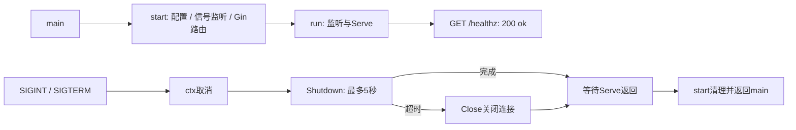

# AsterFlow · 星流

**企业级 Agent 编排与治理平台。**

AsterFlow 将模型、提示词、技能、工具、知识库与多Agent编排纳入版本化控制面，为业务提供可追踪、可审批、可评估的Agent执行能力。

## 项目状态

需求与架构已通过PR #3。本分支已实现配置、Gin健康接口、HTTP监听/优雅关闭与信号退出，完成本地验收，正在准备ENG-001功能PR；尚未合并到main或发布。功能状态以[交付状态](docs/delivery/STATUS.md)为准，不将设计目标表述为现有能力。

目标范围包括：身份与空间权限、模型管理、Prompt治理、五源工具、Skills、知识检索、Agent/Team、审批与A2UI、Guard、Eval、审计观测、外部渠道、SDK/CLI、独立业务场景及部署。

## 文档导航

| 文档 | 用途 |
| --- | --- |
| [产品需求](docs/product/PRD.md) | 用户、场景、功能与验收 |
| [架构设计](docs/architecture/ARCHITECTURE.md) | 系统边界、分层、运行与部署 |
| [模块职责](docs/architecture/MODULES.md) | 模块依赖、责任和交付边界 |
| [数据模型](docs/architecture/DATA-MODEL.md) | 实体、版本、事务和租约 |
| [接口约定](docs/architecture/API-CONVENTIONS.md) | HTTP、事件、错误和权限 |
| [迭代Backlog](docs/delivery/BACKLOG.md) | Epic、任务顺序与验收 |
| [协作规范](CONTRIBUTING.md) | 分支、提交、PR与合并 |
| [代码评审](docs/process/CODE-REVIEW.md) | 评审维度、问题分级和复审 |
| [完成标准](docs/process/DEFINITION-OF-DONE.md) | 交付必须具备的证据 |
| [首项工程任务](docs/tasks/ENG-001.md) | 配置与HTTP基础服务任务 |
| [需求追踪](docs/reference/TRACEABILITY.md) | 需求到模块、任务和证据的映射 |
| [架构决策](docs/architecture/adr/0001-reference-and-boundaries.md) | 技术基线与设计取舍 |

## 文档检查

Python 3.9+，无需第三方依赖：

```bash
python3 scripts/check_repo.py
python3 -m unittest discover -s scripts -p 'test_*.py' -v
git diff --check
```

当前后端命令和执行路径如下；前端尚未迁移。

## 后端启动与检查

本机需要make、Python3.9+及可用Go。Makefile以命令级固定Go1.26.6，不修改全局环境。

```bash
make run
```

默认监听:18090，另开终端：

```bash
curl -i http://127.0.0.1:18090/healthz
```

预期200、text/plain、正文ok；POST /healthz为405，未知路径或/healthz/为404。在服务终端Ctrl+C停止；SIGTERM同样触发最多5秒优雅关闭，超时关闭连接。普通Handler需配合context取消。

```bash
ASTERFLOW_HTTP_ADDR=127.0.0.1:18091 GIN_MODE=release make run
make check
make build
./bin/asterflow
```

make check执行文档、依赖一致性、race测试、vet和构建；build生成的bin目录已忽略。配置变量未设置时用默认，显式空白或非法host:port/端口1–65535以错误退出。接口仅报告进程存活，不表示PG/Redis或任何业务能力已就绪。

## 当前启动与退出路径



[本地验收记录](docs/delivery/ENG-001-VERIFICATION.md)列明已运行和未运行范围。数据库、认证、模型、Agent及其他目标模块后续按Backlog实现，不以本切片代替完整产品验收。

## 协作

采用Issue → 功能分支 → PR → CI → Review → 修复/复审 → Squash合并。main只接收评审后的变更。新克隆可启用本地防误推hook：

```bash
git config --local core.hooksPath .githooks
```

服务端保护、单账号评审限制和实际配置见[仓库治理](docs/process/REPOSITORY-GOVERNANCE.md)。

## 来源与许可

技术参考与固定基线见[第三方说明](THIRD_PARTY.md)和[基线记录](docs/reference/BASELINE.md)。项目采用[Apache-2.0](LICENSE)，保留适用的原项目来源与版权说明。
