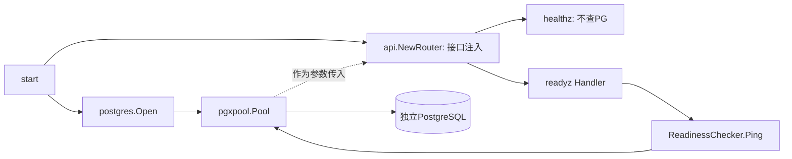
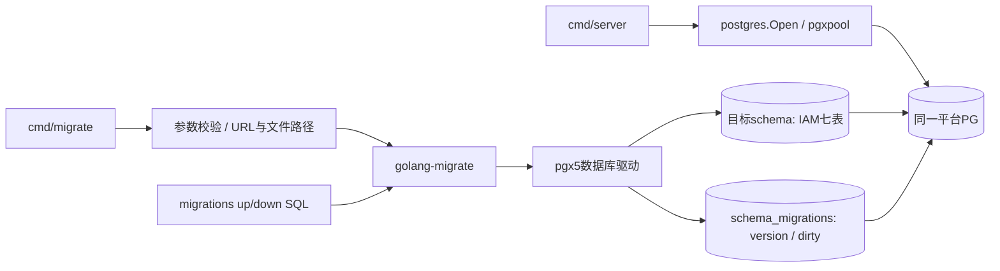
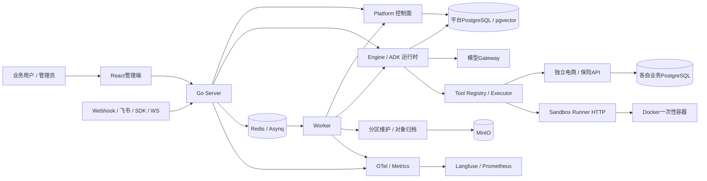

# AsterFlow架构设计

目标架构版本0.1已通过设计PR #3；ENG-001基础HTTP已合并，ENG-002的PG连接/就绪切片已通过PR #6合并，固定HEAD Review及远程CI通过。其他模块仍为目标设计；约束来自[PRD](../product/PRD.md)。[ADR-0001](adr/0001-reference-and-boundaries.md)记录基线和取舍。

## 当前增量：PG基础设施

ENG-001/ENG-002已合并；以下实际装配路径的本地真实PG/HTTP及中断恢复、远程CI和Review已验证。其余系统图仍表示目标设计。



ReadinessChecker定义在API消费方；API无需import postgres包，由main注入满足接口的pool。入口掌握资源生命周期，run退出后才关闭池。业务服务/Store尚未实现；ENG-003迁移进度见下文，不能将图中的PG连接当成业务持久化完成。

## 当前增量：迁移命令

ENG-003在独立分支实现迁移CLI与IAM初始SQL；严格query校验已修复并通过完整复验，开发public已实际应用000001。当前待提交/PR，尚未生产部署。



迁移CLI与server各自管理连接，API层不负责DDL。框架版本表和业务表区分；测试临时schema与开发public区分。本轮分别记录临时schema验证与开发public首次up成功，详细证据见[ENG-003验收](../delivery/ENG-003-VERIFICATION.md)。

## 方案与取舍

采用模块化Go平台，server/worker独立进程，共享PG/Redis；Sandbox Runner独立服务；业务系统独立进程/数据库。该方案复用固定技术基线的控制面/运行时边界，事务边界清楚、单机可部署，后续通过既有HTTP/任务协议拆分。
将每个模块立即拆成微服务会引入额外鉴权/网络/事务协调，偏离当前基线；单进程同时持有Docker Socket又无法保持执行隔离。因此选前者，不新增服务网格等未要求设施。

技术：Go 1.26.6、Gin v1.12.0、pgx/sqlc、PostgreSQL/pgvector、Redis/Asynq、Eino v0.9.15、React/TypeScript/Ant Design/Vite、MinIO、OTel/Prometheus/Langfuse。依赖版本进入对应实现PR时锁定，不能仅凭此文档声称已安装。

## 系统与部署边界



平台不直接查询业务数据库；独立业务不依赖平台表。Server/Worker不挂Docker Socket，仅Runner持有。测试环境与日常数据隔离，外部网络/密钥由配置注入。

## 代码分层与依赖

| 层/目录 | 职责 | 允许的依赖 |
| --- | --- | --- |
| cmd/server、cmd/worker、cmd/sandbox-runner | 启动装配/生命周期/配置注入 | 组装下层，不承载业务规则 |
| internal/api | HTTP/WS/SSE、认证context、请求响应映射 | platform与engine公开能力 |
| internal/platform | 配置/版本/成员/审批/审计/Eval等业务规则、Store接口与PG适配 | domain、基础设施；在固定基线需要时适配runtime接口 |
| internal/runtime | 运行时Engine/LLM/Tool/Skill/KB/Guard/Team | domain、消费者定义的接口和基础设施；既有tool凭据/Schema适配按基线保留 |
| internal/infrastructure | PG/Redis/Jobs/对象存储/观测 | 不依赖API/业务Handler |
| internal/domain、internal/util | 共享领域结构与纯工具 | 不依赖HTTP或启动层 |
| web/admin | 页面/状态/请求适配 | 仅调用公开API，不充当鉴权依据 |
| business_systems/* | 独立业务module/API/Store/迁移 | 自己的PG，只经协议暴露业务 |

采用接口满足调用需求，通常在消费者处定义；不为“有一个结构体”机械增加接口。不引入Go包循环；实际允许的跨层适配由接口/ADR说明，不能把架构图当编译依赖精确列表。

## 目标目录

```text
cmd/{server,worker,sandbox-runner,asterctl,mockllm}/
internal/api/{middleware,streaming,v1}/
internal/platform/{iam,prompt,modelconfig,tool,skill,kb,agent,approval,team,guardconfig,audit,eval,maintenance,preset}/
internal/runtime/{engine,llm,tooling,skillrunner,retriever,sandbox,team,guard,cache,promptcache}/
internal/infrastructure/{postgres,redis,jobs,objstore,otel,metrics}/
internal/{config,domain,util,a2ui,integration}/
migrations/
web/admin/
business_systems/{crossborder,insurance}/
pkg/sdk/{go,openapi}/
deploy/
docs/
```

其中上游CLI入口名kbotctl是来源路径，目标产品CLI计划命名asterctl，源文件映射记录于基线；不改变SDK/CLI能力。业务/平台module路径以仓库github.com/yz1qaq/asterflow为根，各独立module在任务中明确。表中目录当前未创建，禁止以目录清单冒充已实现。

## 主流程：配置与执行

1. 认证用户在可信空间创建/发布Prompt、模型Profile、工具、技能、Agent/Team具体版本。
2. 会话创建时解析环境/灰度并固化具体依赖，后续不随指针更新漂移；KB名单冻结ID范围，内容可继续同步。
3. 请求先通过身份/空间/资源归属检查，Engine领取会话租约并续租。
4. Guard on_input后，Gateway计划使用固定模型配置；ADK按工具/Skill/KB范围执行，每次调用再校验。
5. Tool结果以同级tool message回传模型，模型继续生成；SSE/WS事件经接入层编码，不把终态全文重复追加。
6. on_output后在同一事务中验证租约并保存整轮用户/助手/tool消息；错误/取消按明确状态释放，不伪造成功。
7. 审计/用量/trace关联同一用户、空间、会话和工具调用；事实数据以业务库为准，观测系统不替代事实库。

## 审批与恢复

敏感工具调用在真正执行前生成pending与框架中断状态。保存的checkpoint包含ADK框架状态/interrupt address，不是仅一段聊天文本。审批关联用户归属所在Conversation/Workspace；A2UI是受控展示/动作协议，仍需真正后端鉴权。
批准/拒绝状态更新使用原子条件；批准后经任务/扫描恢复，先领取执行租约再定点恢复；恢复/失败更新带执行token。不同租约分别防会话并发和审批重复消费。审批与checkpoint写入、任务投递失败补偿须在审批任务设计中明确，不声称Postgres事务能原子提交Redis消息。
外部业务写操作依靠其自身幂等键/事务约束抵御重试，平台不能仅靠锁声称全链路exactly-once。

## 知识摄取与检索

目录同步→来源/文档/hash→Job事实→Redis任务→Worker读取/切块/Embedding→PG/pgvector索引→状态更新。重试和重复同步以内容和作业状态治理。
检索使用可信workspace/KB范围、模式路由、全文/向量/RRF与参考重排；检索片段作为工具消息进入Agent。模型暴露Schema只作引导，实际Executor再次校验KB/工具权限。
LocalEmbedder仅用于流程验证，实际语义质量需要明确模型和语料验收；Embedding缓存隔离模型/维度/输入。

## 错误、并发与事务

服务层校验业务，Store校验数据库可表示性，DB约束兜底。包装错误保留cause，公开响应不泄露SQL/URL密钥。
配置主记录与首版、版本与环境绑定、会话整轮消息等必要组合写入原子事务。锁/条件更新保护实际不变量，普通事务不等于自动解决所有并发。
请求context在API入口建立并传播；清理和持久化收尾使用有界独立context，不能无限后台续租。

## 演进边界

当前不新增SSO/OIDC、OpenSearch、Kubernetes/HA等上游尚未实现的系统。真正落地范围为PRD与固定已实现基线；任何差异按ADR/PR记录。


## HTTP接入适配

负责人2026-11-15确认后端采用Gin，前端保留React；详见[ADR-0003](adr/0003-gin-http-adapter.md)。NewRouter保持返回http.Handler，Server生命周期不依赖具体框架。gin.Context只在API/中间件使用，业务/运行时继续传c.Request.Context()得到的标准context.Context。框架替换不改变既定权限、事件、状态码和主要业务逻辑；差异逐项以契约测试核对。


## ENG-001实现切片

cmd/server/main.go中的main只处理日志/退出码，start装配config.Load/Gin/信号并调用run；run.go集中监听与关闭，配置/API各保留单一职责。35个场景含真实进程和信号已本地通过，详见[验收](../delivery/ENG-001-VERIFICATION.md)；该历史切片已通过PR #4合并。PG增量见上文ENG-002；Agent、前端等其他目标功能尚未完成。
