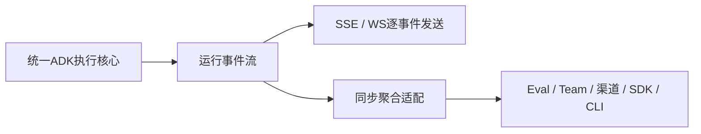

# ADR-0004：按功能需求组合并交付与运行时实现取舍

状态：负责人2026-11-15明确批准。完整分组见[交付计划](../../delivery/ROADMAP.md)，对应18项需求/19模块，固定参考SHA及功能范围不变。

## 背景与决定

原ENG-001/002/003按基础机制分别交付，后续不延续每个小改动单独提交的节奏。保留ENG子任务编号，自004起按G01–G22合并，默认一个需求组对应一个Issue、分支和PR；SQL/Store/Service/API/前端/测试/文档作为同一功能闭环。
需求组可跨多个每天3–4小时的学习时段；组内成组给代码并讲解，简单改动不逐项中断做全量验证，真实故障及时修复，最后集中验收。人类继续编写生产Go/SQL和操作提交/推送/合并，助手负责前端/验证/文档/运维/AI审查。
001/002已有合并历史不重写，003按当前流程收尾；从004+005的用户登录组开始应用。

## 完整功能与实现精简

完整以固定参考已经实现的功能、协议、权限、版本/并发与失败语义为准，不要求逐函数/逐文件复制。以下取舍只减少重复或过渡实现：
- 业务持久化直接PG，不先写生产内存业务Store再替换；这不删除缓存/运行时内存状态或测试替身。
- 直接真实模型适配和统一ADK执行核心，不先构建假回答/模拟Planner/把完整答案切块假装流式的主流程。
- 有工具/无工具统一执行；所需Tool/Skill/KB逐组正式接入，不制造默认放行的假实现。
- 所有生产Store都要求事务能力时，在消费者接口明确要求该能力，省略只为无事务Store保留的生产fallback。
- 无调用方的包装入口/兼容分支在核对调用图后省略；测试夹具与Mock LLM仍用于可重复验证，不成为静默生产fallback。
- sqlc生成查询不手抄生成代码。目录/文件允许合并，但包边界、协议与不变量保持。

## 同步与流式不是两套执行器

固定参考engine/engine.go的Chat调用ChatStream并收集事件；Eval、Team member、integration、Lark job、SDK/CLI存在完整结果调用方。因此保留同步薄适配，不能把同步能力一概视为过渡实现。

目标设计（尚待对应需求组实现）：

只维护一份执行/权限/历史/租约/审批与保存流程。同步聚合保留会话/trace/审批状态和错误、取消语义，不能把等待审批误报完成。SSE/WS继续按原事件契约输出。
模型层的Generate/Stream是实际框架/调用方需要的接口，保留并共享配置、路由及治理逻辑，不因网页默认流式删除它们。

## 验证与追踪

每项跳过或整合的参考实现，记录原用途、真实调用方、目标替代路径和验证证据；G22按能力/路由/页面/SDK/协议及26组迁移语义核验。488文件清单不改SHA、不以复制数量宣称完成。
常规相关功能不再按层拆PR；如果实际差异确需拆分，说明可独立验收的边界，仍保留完整需求组与追踪。代码审查和远程CI要求不变，AI COMMENT不等于独立人类Approve。
